<div align="center">

# Desky
### Smart Desk Automation for Local LAN

[](https://kotlinlang.org/)
[](https://developer.android.com/jetpack/compose)
[](https://ktor.io/)
[](https://platformio.org/)
[](LICENSE)

*A personal setup I built to control my entire workstation—booting my laptop remotely via an AC relay, dispatching clean Windows power commands, and controlling ambient RGB lighting—directly from my Android phone over local Wi-Fi (currently built and used just by me).*

<br/>

| Home Dashboard | Peripherals Overview | Workstation Controls | Ambient LED Control | Settings & Discovery |
|:---:|:---:|:---:|:---:|:---:|
| 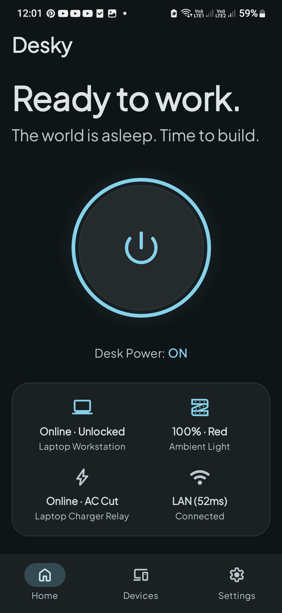 | 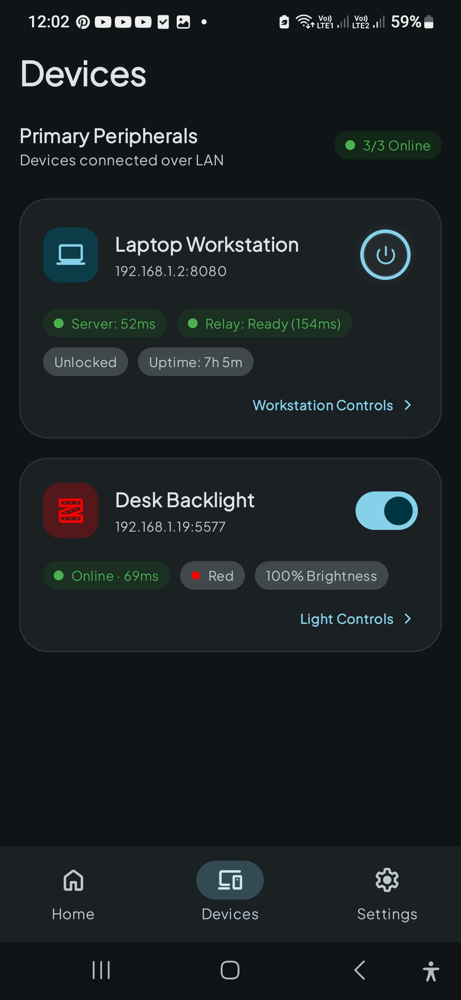 | 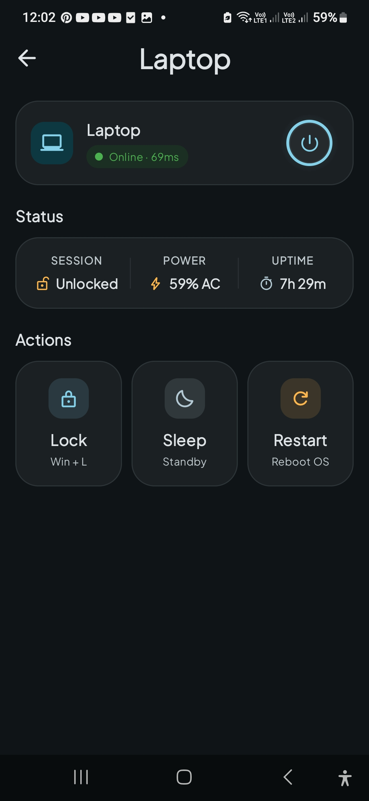 | 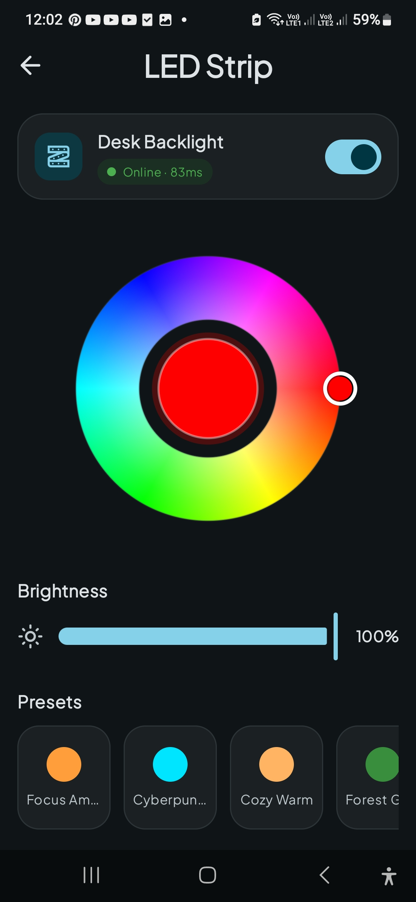 | 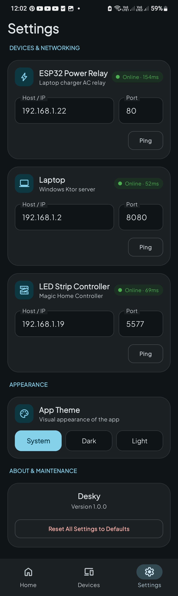 |

</div>

---

## 💡 Why I Built Desky

As a Computer Science student, I love building projects that solve real annoyances in my daily routine—and this made for the perfect side project to have fun with and learn from across the entire stack, from embedded hardware to mobile.

My desk routine had an annoying ritual: every time I wanted to work, I had to walk over to my desk, press the laptop power button, wait around, and then hunt for the physical remote just to turn on the desk backlight. What I really wanted was simple: **wake up or step through the door, tap one button from bed, and have my entire workstation — laptop booted, Windows ready, and ambient lighting set — waiting for me before I even sit in the chair.**

Existing off-the-shelf options fell short:
- **Wake-on-LAN (WoL)** is not supported by my laptop, and I don't think it would have served my use case well anyway since I wanted to turn my laptop on from a true cold shutdown.
- **Commercial Smart Plugs** are good, but I wanted full control over the device and communication protocol so I could integrate it directly into my own Android app without relying on third-party cloud services.

However, my laptop's BIOS supports booting automatically whenever AC charger power is detected. Having the components and some basic embedded skills from my high school days, I decided to build my own smart controller using an **ESP32 and a 5V relay module**. This gave me complete ownership of the hardware, local firmware, and communication protocols without any proprietary black boxes or subscriptions.

On the software side, Desky ties the entire experience together:
- **Morning Ritual**: One tap from anywhere in the room restores AC power to boot the laptop, turns on the backlight, and displays real-time telemetry.
- **Night Ritual**: When I'm done working and heading to bed, one tap concurrently dispatches a clean Windows OS shutdown, resets the charger relay, and turns off the lights so I can just walk away.
- **Extensible Architecture**: Engineered with a clean modular structure so I can easily plug in more desk peripherals (monitors, smart audio, sensors) in the future.

---

## 📐 Architecture & How It Works

Desky connects four distinct nodes on your local network without any external internet bridge:

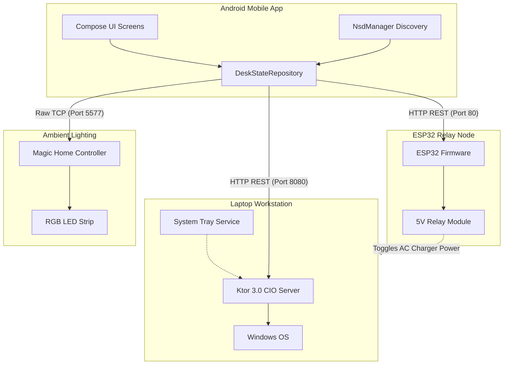

### Protocol & Port Matrix

| Target Peripheral | Protocol | Port | Transport Mechanism | Purpose |
|:---|:---|:---:|:---|:---|
| **ESP32 Relay** | HTTP REST | `80` | JSON / Plaintext | AC charger cut/restore, hardware ping |
| **Laptop Workstation** | HTTP REST | `8080` | JSON (`LaptopTelemetryDto`) | Shutdown, lock, sleep, restart, live battery & uptime |
| **LED Strip Controller** | Raw TCP Socket | `5577` | Custom 4-byte checksum protocol | Real-time RGB color, brightness, power toggle |
| **Network Discovery** | mDNS + UDP | `5353` / `48899` | Multicast DNS (`_desky-*._tcp`) & UDP Broadcast | Zero-config IP resolution & auto-healing |

> 📖 **Full API Reference**: For complete JSON request/response schemas, underlying Windows commands, byte packet formulas, and `curl` testing examples, see the [API & Endpoints Documentation](docs/ENDPOINTS.md).

---

### The AC-Boot & Safe Shutdown Lifecycle

Laptops generally cannot be turned on via Wake-on-LAN when powered off. Desky solves this by exploiting the BIOS feature that **boots automatically whenever AC charger power is detected**:

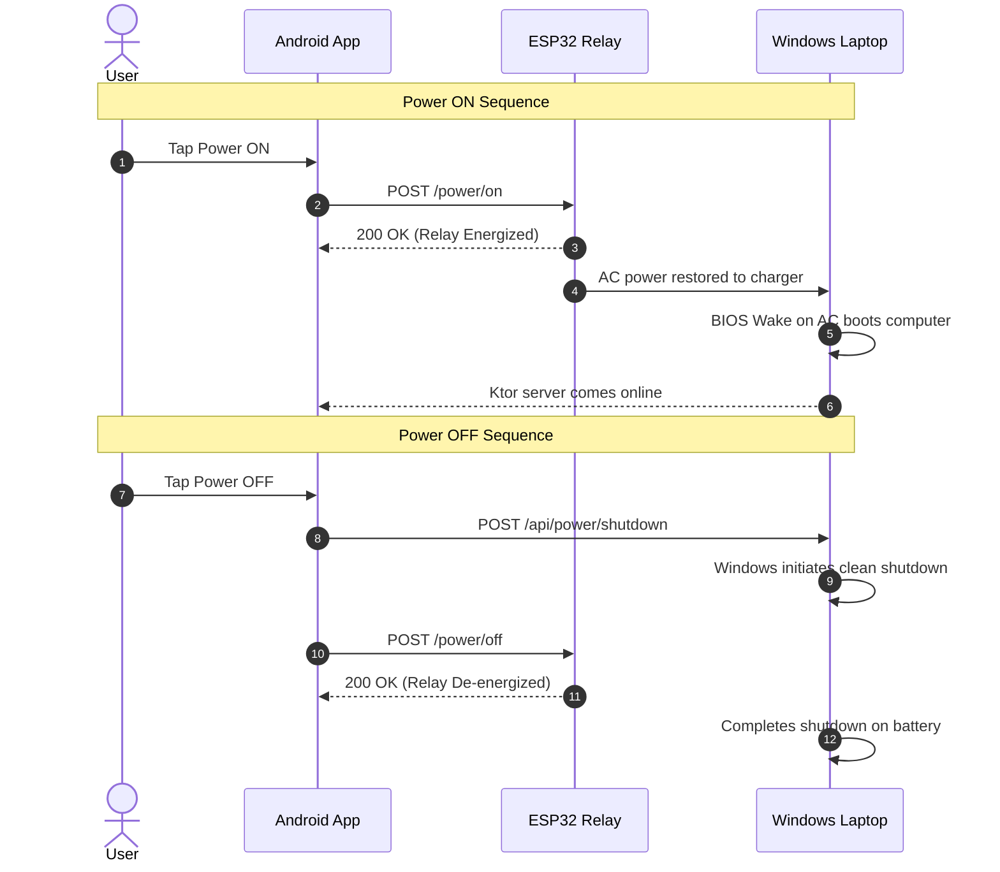

> [!NOTE]
> Because laptops have an internal battery, de-energizing the charger relay while Windows performs its shutdown routine poses zero risk of file corruption or sudden power loss. The charger relay returns to its unpowered state, ready for the next boot cycle.

---

## ✨ Features Tour

### 🏠 1. Home Dashboard
- **Dynamic Contextual Greeting**: Adapts dynamically based on time of day.
- **Master Desk Power Button**: Single-tap toggle to boot or power down the entire desk ecosystem.
- **Live Telemetry Bento Grid**: Glanceable cards showing Workstation state (Locked/Unlocked), Ambient Light color/state, Charger Relay status, and Wi-Fi LAN round-trip latency.

### 📱 2. Peripherals Overview
- **Live Health Status**: Overview counter showing online peripherals (e.g. `3/3 Online`).
- **Individual Quick Controls**: Direct power toggle switches for workstation and LED strip.
- **Diagnostics**: Independent server and relay ping latency metrics displayed in real time.

### 💻 3. Laptop Workstation Controls
- **Remote OS Power Actions**:
  - **Lock**: Win + L lock workstation immediately.
  - **Sleep**: Standby low-power mode.
  - **Restart**: Graceful Windows restart.
  - **Shutdown**: Safe coordinated system shutdown.
- **Live Diagnostics**: Real-time battery percentage, charging state, session lock state, and system uptime.

### 💡 4. Ambient LED Light Controller
- **HSV Color Wheel**: Fluid, responsive color wheel for choosing any RGB color.
- **Brightness Slider**: 0–100% fine-grained brightness adjustment.
- **One-Tap Presets**: Instant mood switching (Focus Amber, Cyberpunk, Cozy Warm, Forest Green).

### ⚙️ 5. Zero-Config Settings & Networking
- **Autonomous Discovery**: Background mDNS beaconing and UDP scan automatically register device IPs.
- **Manual Overrides**: Field configuration with live ping test buttons to verify reachability.
- **Theme Selector**: System Default, Dark Mode, and Light Mode.

---

## 🛠️ Hardware Requirements & Bill of Materials (BOM)

To build the hardware components of Desky, you will need:

| Component |                                      Preview                                       | Recommendation                                   | Function                                             |
|:---|:----------------------------------------------------------------------------------:|:-------------------------------------------------|:-----------------------------------------------------|
| **Microcontroller** |             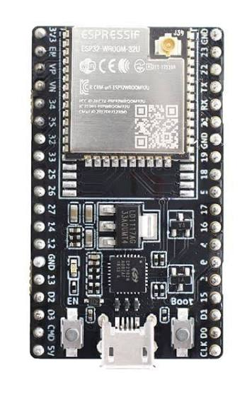              | ESP32-WROOM-32U / DevKit (with IPEX antenna)     | Hosts HTTP REST server & mDNS beacon                 |
| **Wi-Fi Antenna** |                | 2.4GHz Omni Antenna + IPEX (U.FL) to SMA Pigtail | High-gain external Wi-Fi reception through enclosure |
| **Relay Module** |          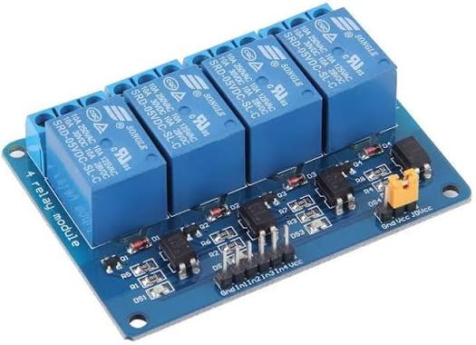          | 5V Relay Module (4-Channel or 1-Channel)         | Toggles AC mains line to laptop charger              |
| **Power Breakout** |          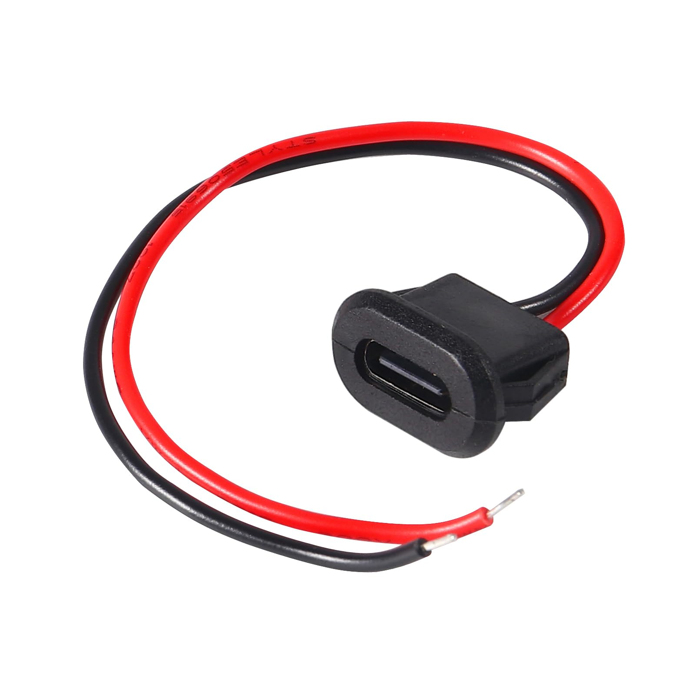           | USB Type-C Female Breakout Board                 | Supplies 5V DC power to ESP32 & relay                |
| **AC Male Plug** |        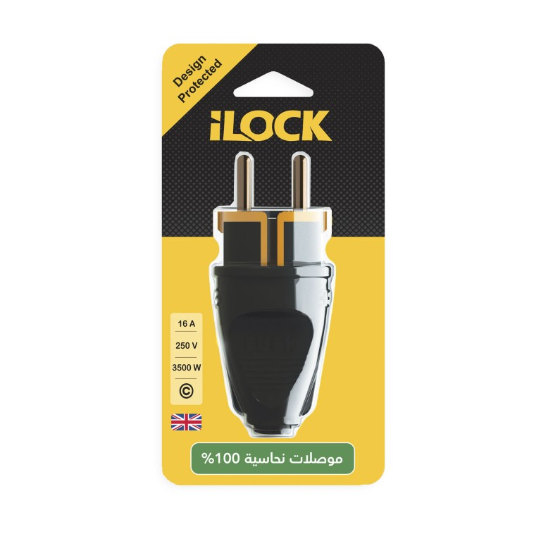        | Heavy-duty 2-pin male plug                       | Connects to wall outlet / power strip                |
| **AC Female Socket** |          | Inline 2-pin female socket                       | Receptacle for laptop charger plug                   |
| **Enclosure** |        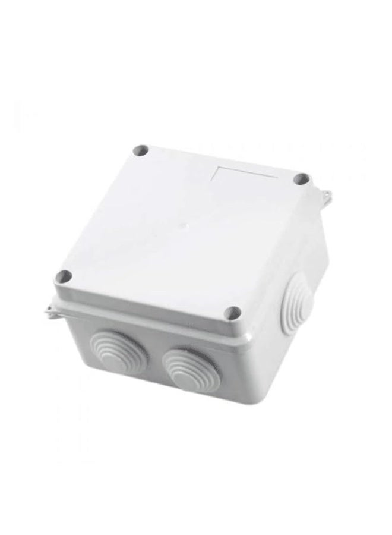        | Insulated electrical junction box (100mm)        | Safe, insulated protective housing                   |
| **LED Controller** | 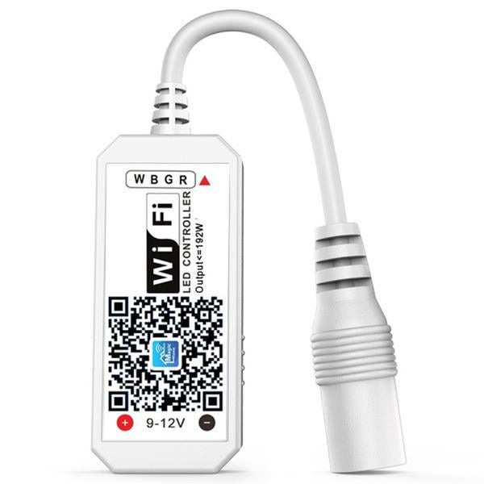 | Magic Home Wi-Fi RGB Controller (Flux/Zengge)    | Drives 12V RGB LED strip                             |
| **LED Strip** |         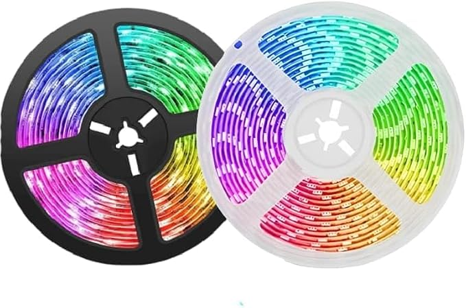          | 12V RGB Strip (4-pin)                            | Ambient desk backlighting                            |

> [!TIP]
> **Ambient Lighting**: The backlight is just a generic, off-the-shelf 12V RGB LED strip that originally came with just an infrared remote. I replaced the stock IR box with an inexpensive Wi-Fi controller compatible with the **Magic Home** app. Desky communicates with it directly over local Wi-Fi via raw TCP sockets on port `5577` (and auto-discovers it via UDP broadcast on port `48899`), completely bypassing the proprietary Magic Home mobile app and any cloud servers.

### ⚡ Custom Relay Hardware Build

<div align="center">

| Complete Assembled Unit | Antenna & Cable Passthrough | External USB-C Power Port |
|:---:|:---:|:---:|
| 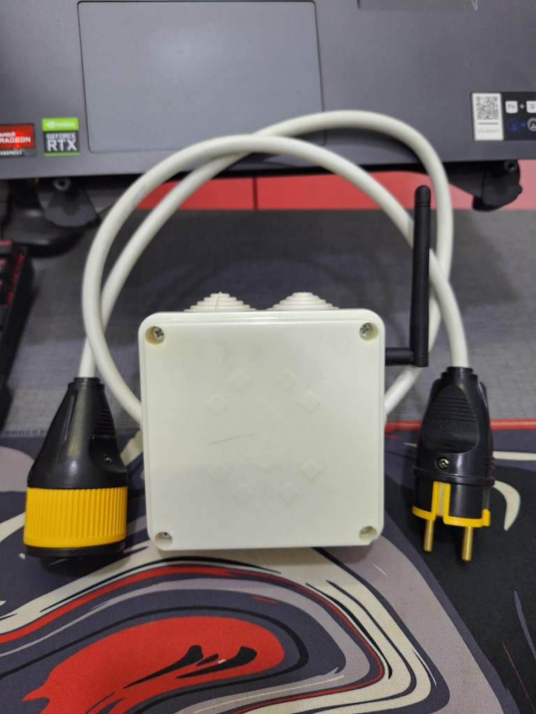 | 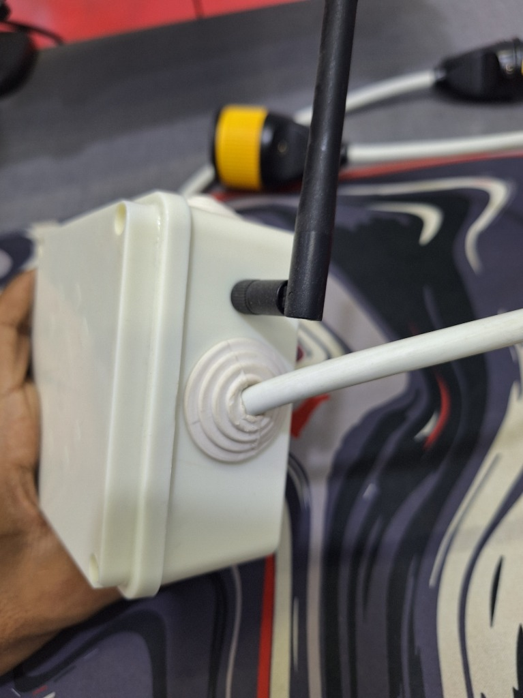 | 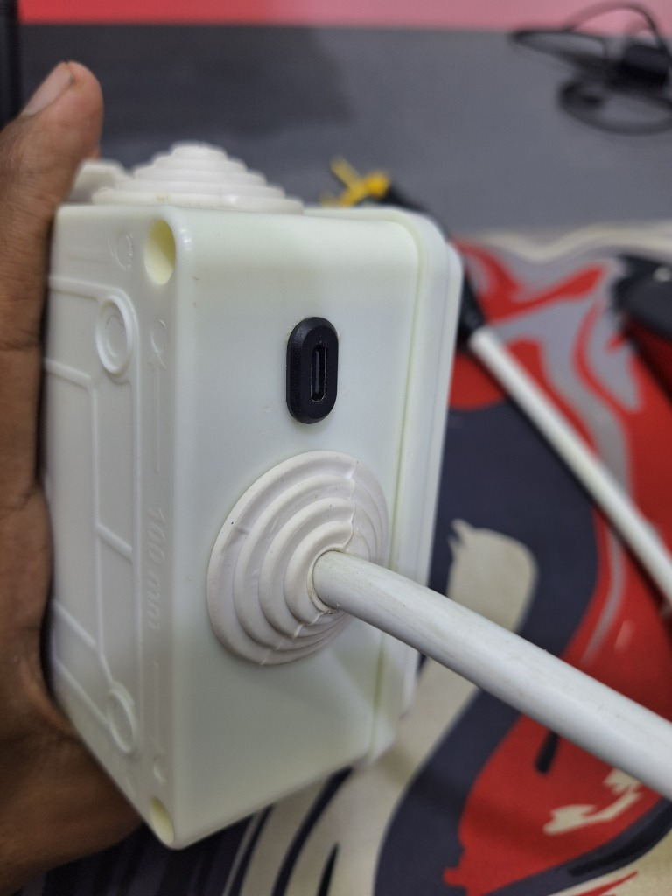 |

*Left: Assembled controller with 2.4GHz omni antenna and inline AC extension cord with male/female plugs. Center: Side profile showing the external antenna mount and sealed cable gland. Right: Close-up of the external USB-C 5V power socket and rubber cord grommet.*

</div>

### ⚡ Simplified Wiring Diagram

```text
                  ┌──────────────┐
                  │    ESP32     │
                  └──────┬───────┘
                         │ GPIO 4 (Active-LOW)
                         ▼
                  ┌──────────────┐
[ AC Wall Mains ] ┤ Relay Module ├─> [ Laptop Charger ]
                  └──────────────┘
```

> **Note**: This is a simplified representation. The physical enclosure also houses a mini breadboard, an external USB-C socket powering the 5V rails, an external 2.4GHz whip antenna, and a 4-channel relay module (Channel 1 controls the laptop charger, leaving 3 channels for future expansion).

#### Direct Wiring Reference

| From | To | Function |
|:---|:---|:---|
| **5V Power Source** | ESP32 `VIN` & Relay `VCC` | 5V DC system power |
| **Power Ground** | ESP32 `GND` & Relay `GND` | Common DC ground |
| **ESP32 `GPIO 4`** | Relay `IN1` | Active-LOW relay trigger |
| **AC Wall Plug (Live)** | Relay `COM` | AC mains input |
| **Relay `NO`** | Laptop Charger (Live) | Switched AC output to charger |
| **AC Wall Plug (Neutral)** | Laptop Charger (Neutral) | Direct AC passthrough (2-pin plug) |

> [!CAUTION]
> ### ⚠️ DANGER: LETHAL HIGH VOLTAGE WARNING
> **Mains AC electricity (110V–240V) carries lethal electrical shock risk that can cause severe injury, electrical fire, or death.**
>
> - **Never touch the circuit while energized**: Always unplug the AC cord from the wall outlet before opening the enclosure, inspecting the board, or handling any wiring.
> - **Exposed Live Terminals**: The screw terminals on the relay module carry uninsulated live mains AC voltage. Never test or probe the circuit with bare hands while plugged into mains power.
> - **Proper Insulation**: Fully insulate all wire splices with heat-shrink tubing and house the entire assembly inside a closed, non-conductive project box with secure cable strain reliefs.
> - **Know your limits**: If you are unfamiliar with or uncomfortable working with mains AC wiring, consult a qualified electrician or use a pre-certified enclosed smart plug.
> - **Disclaimer**: You build and operate this hardware entirely at your own risk. The author assumes no responsibility or liability for any electrical shock, injury, damage, or fire resulting from following this schematic.

---

## 📂 Monorepo Structure

```text
Desky/
├── app/
│   └── androidApp/                  # Jetpack Compose Android client (MVI, Navigation 3)
│       └── src/main/kotlin/org/example/desky/
│           ├── home/                # Master dashboard & telemetry presentation
│           ├── devices/             # Device list, laptop detail, and LED screens
│           └── settings/            # Device discovery & preferences
├── core/                            # Shared domain logic & single source of truth
│   └── src/commonMain/kotlin/org/example/desky/
│       ├── model/                   # Shared DTOs (LaptopTelemetryDto, etc.)
│       └── network/                 # Route constants & network discovery definitions
├── server/                          # Lightweight Ktor CIO Windows server
│   ├── src/main/kotlin/org/example/desky/
│   │   ├── Application.kt           # Server entry point & mDNS advertiser
│   │   ├── LaptopRouting.kt         # REST endpoints (/api/power, /api/actions)
│   │   └── services/                # Windows OS telemetry & ProcessBuilder commands
│   └── scripts/                     # Auto-start and background runner batch scripts
└── esp32/                           # PlatformIO ESP32 firmware
    ├── platformio.ini               # PlatformIO board & library configuration
    └── src/
        └── main.cpp                 # WebServer, WiFiManager captive portal, & relay control
```

---

## 💻 Tech Stack

- **Languages**: Kotlin (Multiplatform 2.0), C++
- **Android & UI**: Jetpack Compose, Material 3, Navigation 3, MVI Architecture, Koin DI, Jetpack DataStore
- **Backend & Systems**: Ktor 3.0 (CIO Engine), Windows System Tray, ProcessBuilder OS automation
- **Embedded & IoT**: ESP32, PlatformIO, Arduino framework, WiFiManager (Captive Portal), ESPmDNS

---

## 📬 Questions & Contact

This repository is a showcase of a personal desk automation project, built and tailored specifically for my own daily routine and hardware setup rather than a plug-and-play consumer product. 

If you have any questions about the setup, want to build something similar for your own desk, or just want to chat about the architecture, feel free to open an issue or shoot me an email at **[sherifmohep@gmail.com](mailto:sherifmohep@gmail.com)**!

---

## 📄 License

This project is licensed under the MIT License — see the [LICENSE](LICENSE) file for details.
