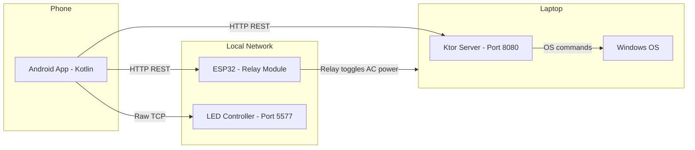

# Desky — Desk Setup Controller

A mobile app to control your desk setup (laptop power, LED strip) from your phone, entirely over the local network with no cloud dependency.

> [!NOTE]
> **Historical Design & Planning Document**: This document captures the initial architecture proposals and technical decisions established prior to implementation. For the finalized system architecture, active endpoints, and hardware setup, please refer to the main [README.md](../README.md) and [docs/ENDPOINTS.md](ENDPOINTS.md).

---

## Architecture Overview



### Communication Summary

| Phone → Target | Protocol | Port | Purpose |
|:---|:---|:---|:---|
| Phone → ESP32 | HTTP REST | `80` | Power on/off laptop via relay |
| Phone → Laptop Server | HTTP REST | `8080` | Shutdown, lock, sleep, future commands |
| Phone → LED Controller | Raw TCP (Magic Home protocol) | `5577` | RGB color, on/off, brightness |

All communication is **local LAN only** — no internet, no cloud accounts, no port forwarding.

---

## Decisions

| Decision | Resolution |
|:---|:---|
| **Network addressing** | **mDNS & UDP Discovery (Zero-Config)**: ESP32 broadcasts `desky-relay.local`, Laptop Ktor server broadcasts `desky-laptop.local`, and Magic Home LED strip is auto-discovered via UDP broadcast (port 48899) with cache-first persistence in DataStore and automatic self-healing on router reboots. |
| **Laptop server auto-start** | Fat JAR starts automatically on boot via Windows Startup folder `.bat` script. |
| **ESP32 Wi-Fi credentials** | Hardcoded in a `credentials.h` file, added to `.gitignore` so it is never pushed to git. |
| **LED strip type** | **RGB** (3 channels, 4 wires). No warm white byte needed. |
| **Project name** | **Desky** (working code name). |

### Laptop Power Sequence

The ESP32 relay controls AC power to the laptop's charger/power brick. The laptop BIOS is configured to **boot when AC power is received**. Because the laptop has an internal battery, cutting AC power to the charger poses zero risk of filesystem damage or hard cuts.

**Power ON:**
1. App sends `relay on` to ESP32
2. ESP32 switches relay → AC power flows to laptop charger
3. Laptop detects AC power and boots automatically via BIOS setting

**Shutdown:**
1. App sends `shutdown` command to Laptop Ktor Server and `relay off` to ESP32 concurrently (or simple sequential dispatch).
2. Laptop executes shutdown while running on its internal battery.
3. The charger relay is de-energized in the OFF state, primed and ready for the next power-on cycle.

> [!NOTE]
> The charger relay **must** be OFF before the next power-on cycle, otherwise toggling it ON has no effect (charger AC power is already flowing). Since the laptop has an internal battery, cutting charger power and triggering shutdown concurrently is safe and instant.
> The Home screen simply monitors laptop reachability / lock status (no CPU/RAM/Battery polling clutter).

---

## Project Structure

A **monorepo** with Kotlin Multiplatform (KMP) to share data models and API constants between the Android app and the laptop server:

```text
Desky/
├── gradle/
│   └── libs.versions.toml                  # Centralized dependency versions
├── settings.gradle.kts
├── build.gradle.kts                        # Root build config
│
├── shared/                                 # KMP shared library
│   ├── build.gradle.kts
│   └── src/
│       └── commonMain/kotlin/
│           └── com/desky/shared/
│               ├── models/                 # @Serializable DTOs
│               │   ├── LaptopCommand.kt    # shutdown, lock, sleep
│               │   ├── DeviceStatus.kt     # online/offline, power state
│               │   └── LedState.kt         # RGB values, on/off
│               └── api/
│                   └── Routes.kt           # Shared route constants
│
├── app/
│   ├── androidApp/                             # Android application module
│   │   ├── build.gradle.kts
│   │   └── src/main/
│   │       ├── kotlin/org/example/desky/
│   │       │   ├── MainActivity.kt
│   │       │   │
│   │       │   ├── navigation/                 # Navigation 3 multi-stack setup
│   │       │   │   ├── NavRoute.kt             # Top-level routes (Home, Devices, Settings)
│   │       │   │   ├── TopLevelBackStack.kt    # Multi-tab backstack manager
│   │       │   │   └── DeskyBottomBar.kt       # NavigationBar with 3 tabs
│   │       │   │
│   │       │   ├── features/
│   │       │   │   ├── home/                   # Tab 1: Home (Single screen)
│   │       │   │   │   └── presentation/
│   │       │   │   │       ├── HomeScreen.kt
│   │       │   │   │       └── HomeViewModel.kt
│   │       │   │   │
│   │       │   │   ├── devices/                # Tab 2: Devices (Nested Graph)
│   │       │   │   │   ├── navigation/
│   │       │   │   │   │   ├── DevicesRoutes.kt   # LaptopDetail, LedDetail routes
│   │       │   │   │   │   └── DevicesEntries.kt  # Nav 3 EntryProvider for devices flow
│   │       │   │   │   └── presentation/
│   │       │   │   │       ├── list/              # Devices list screen (root of tab)
│   │       │   │   │       │   ├── DevicesListScreen.kt
│   │       │   │   │       │   ├── DevicesViewModel.kt
│   │       │   │   │       │   └── components/    # DeviceCard.kt, StatusBadge.kt
│   │       │   │   │       ├── laptop/            # Laptop detail screen
│   │       │   │   │       │   ├── LaptopDetailScreen.kt
│   │       │   │   │       │   └── LaptopViewModel.kt
│   │       │   │   │       └── led/               # LED strip detail screen
│   │       │   │   │           ├── LedDetailScreen.kt
│   │       │   │   │           ├── LedViewModel.kt
│   │       │   │   │           └── components/    # ColorPicker.kt, BrightnessSlider.kt
│   │       │   │   │
│   │       │   │   └── settings/               # Tab 3: Settings (Single screen)
│   │       │   │       ├── data/
│   │       │   │       │   └── SettingsStore.kt   # DataStore for saved IPs
│   │       │   │       └── presentation/
│   │       │   │           ├── SettingsScreen.kt
│   │       │   │           └── SettingsViewModel.kt
│   │       │   │
│   │       │   └── core/
│   │       │       ├── theme/                  # Theme.kt, Color.kt, Type.kt
│   │       │       └── ui/                     # Common composables & patterns
│   │       │
│   │       └── AndroidManifest.xml
│   │
│   └── shared/                                 # Compose Multiplatform shared module
│
├── server/                                 # Laptop Ktor server module
│   ├── build.gradle.kts
│   └── src/main/kotlin/
│       └── com/desky/server/
│           ├── Application.kt              # Ktor entry point
│           ├── routes/
│           │   ├── StatusRoutes.kt         # GET /api/status
│           │   └── CommandRoutes.kt        # POST /api/command
│           └── commands/
│               └── SystemCommands.kt       # Execute OS commands
│
└── esp32/                                  # PlatformIO project (VS Code)
    ├── platformio.ini
    ├── .gitignore
    ├── include/
    │   ├── credentials.h               # Wi-Fi secrets, gitignored
    │   └── credentials.example.h       # Template committed to git
    └── src/
        └── main.cpp                        # Wi-Fi + HTTP server + relay control
```

---

## Proposed Changes

### Component 1: `shared` — KMP Shared Library

Shared `@Serializable` data classes and API route constants used by both the Android app and the laptop server. This ensures the app and server always agree on the JSON shape and endpoint paths.

#### [NEW] `shared/build.gradle.kts`
- Kotlin Multiplatform plugin targeting `androidTarget()` and `jvm()`
- Dependencies: `kotlinx-serialization-json`, `kotlinx-coroutines-core`

#### [NEW] `shared/src/commonMain/kotlin/com/desky/shared/models/LaptopCommand.kt`
```kotlin
@Serializable
data class LaptopCommand(val action: Action) {
    @Serializable
    enum class Action { SHUTDOWN, LOCK, SLEEP }
}
```

#### [NEW] `shared/src/commonMain/kotlin/com/desky/shared/models/DeviceStatus.kt`
```kotlin
@Serializable
data class DeviceStatus(
    val name: String,
    val online: Boolean,
    val details: Map<String, String> = emptyMap()
)
```

#### [NEW] `shared/src/commonMain/kotlin/com/desky/shared/models/LedState.kt`
```kotlin
@Serializable
data class LedState(
    val isOn: Boolean,
    val red: Int, val green: Int, val blue: Int,
    val warmWhite: Int = 0
)
```

#### [NEW] `shared/src/commonMain/kotlin/com/desky/shared/api/Routes.kt`
```kotlin
object Routes {
    const val LAPTOP_STATUS  = "/api/status"
    const val LAPTOP_COMMAND = "/api/command"
    const val ESP_POWER      = "/power"
    const val ESP_STATUS     = "/status"
}
```

---

### Component 2: `server` — Laptop Ktor Server

A lightweight local HTTP server running on the laptop. Uses **Ktor with the CIO engine** (~20 MB RAM, sub-second startup, pure Kotlin, no native dependencies). Listens on `0.0.0.0:8080` so the phone can reach it over Wi-Fi. Broadcasts its local hostname (`desky-laptop.local` or native Windows mDNS `<computer-name>.local`) so the mobile app requires zero IP configuration.

#### [NEW] `server/build.gradle.kts`
- Ktor plugin with `buildFatJar` task for standalone JAR
- Dependencies: `ktor-server-core`, `ktor-server-cio`, `ktor-server-content-negotiation`, `ktor-serialization-kotlinx-json`, `jmdns` (for mDNS hostname advertising)
- Depends on `:shared` module

#### [NEW] `server/src/main/kotlin/com/desky/server/Application.kt`
- `embeddedServer(CIO, host = "0.0.0.0", port = 8080)` entry point
- Installs `ContentNegotiation` with `kotlinx.serialization`
- Advertises `desky-laptop.local` via mDNS
- Configures routing modules

#### [NEW] `server/src/main/kotlin/com/desky/server/routes/StatusRoutes.kt`
- `GET /api/status` → returns laptop hostname, uptime, and `"online": true`

#### [NEW] `server/src/main/kotlin/com/desky/server/routes/CommandRoutes.kt`
- `POST /api/command` → receives `LaptopCommand`, dispatches to `SystemCommands`
- Returns success/failure JSON response

#### [NEW] `server/src/main/kotlin/com/desky/server/commands/SystemCommands.kt`
- Executes Windows commands via `ProcessBuilder`:
  - **Shutdown**: `shutdown /s /t 5` (5-second grace period)
  - **Lock**: `rundll32.exe user32.dll,LockWorkStation`
  - **Sleep**: `rundll32.exe powrprof.dll,SetSuspendState 0,1,0`

#### Auto-Start on Boot
- A `start-desky-server.bat` script placed in the Windows Startup folder:
  ```bat
  @echo off
  start /min javaw -jar "C:\Desky\desky-server.jar"
  ```

---

### Component 3: `esp32` — Relay Controller Firmware

An Arduino/PlatformIO project for the ESP32 that hosts a simple HTTP server and controls a relay module to toggle AC power to the laptop charger.

#### [NEW] `esp32/platformio.ini`
- Board: `esp32dev` (or your specific board)
- Framework: `arduino`
- Libraries: `ESPAsyncWebServer`, `AsyncTCP`, `ESPmDNS`

#### [NEW] `esp32/src/main.cpp`
Key functionality:
- **Wi-Fi connection** using SSID/password from `credentials.h` (gitignored, with `credentials.example.h` as a template)
- **mDNS broadcast**: Calls `MDNS.begin("desky-relay")` so the device is resolvable on LAN as `http://desky-relay.local` without relying on dynamic DHCP IPs
- **HTTP endpoints**:
  - `GET /status` → returns `{"relay": "on"|"off", "uptime": 12345}`
  - `POST /power` with body `{"action": "on"}` or `{"action": "off"}` → toggles relay GPIO pin
  - `POST /power` with body `{"action": "pulse"}` → turns relay ON for 2 seconds then OFF (simulates a power button press)
- **Relay GPIO**: Configurable pin (e.g., GPIO 5), active-HIGH or active-LOW depending on your relay module
- **Status LED**: Optional onboard LED blink to indicate Wi-Fi connection status

---

### Component 4: `app:androidApp` — Mobile App

The main control interface, built with **Jetpack Compose**, **Material 3**, and **Jetpack Navigation 3**.

#### Dependencies
- Android application plugin, min SDK 26, target SDK 35
- Dependencies: Jetpack Compose, Navigation 3 (`androidx.navigation3:navigation3-ui`, `navigation3-runtime`), Ktor Client (OkHttp engine), DataStore Preferences, `:shared` / `:core` module

#### Navigation Architecture (Navigation 3)

The app features a 3-tab bottom bar (`NavigationBar`) with multiple backstacks preserved across tabs via `TopLevelBackStack`:

```text
┌─────────────────────────────────────────────────────────────┐
│                      Desky Mobile App                       │
├───────────────────┬─────────────────────┬───────────────────┤
│    Tab 1: Home    │   Tab 2: Devices    │  Tab 3: Settings  │
│                   │   (Nested Graph)    │                   │
│  - Quick actions  │  ┌────────────────┐ │  - ESP32 IP       │
│  - Desk overview  │  │  Devices List  │ │  - Laptop IP      │
│  - Overall status │  └───────┬────────┘ │  - LED Strip IP   │
│                   │     ┌────┴────┐     │  - Saved via      │
│                   │     ▼         ▼     │    DataStore      │
│                   │  [Laptop]   [LED]   │                   │
│                   │  Detail    Detail   │                   │
├───────────────────┴─────────────────────┴───────────────────┤
│         [ 🏠 Home ]     [ 📱 Devices ]     [ ⚙️ Settings ]   │
└─────────────────────────────────────────────────────────────┘
```

1. **Tab 1 — Home (`HomeScreen.kt`)**: Single top-level screen for quick actions, master desk power state, and high-level telemetry.
2. **Tab 2 — Devices (Nested Graph)**:
   - **Root (`DevicesListScreen.kt`)**: Overview card list of all registered hardware devices (Laptop, LED Strip, ESP32).
   - **Nested Screen 1 (`LaptopDetailScreen.kt`)**: In-depth laptop controls (Power ON via ESP32 relay, Shutdown, Lock, Sleep, live uptime).
   - **Nested Screen 2 (`LedDetailScreen.kt`)**: Color wheel/picker, brightness slider, presets (warm white, cool white, party mode), on/off toggle.
3. **Tab 3 — Settings (`SettingsScreen.kt`)**: Zero-config device discovery and desk preferences:
   - **Device Endpoints**:
     - ESP32 Relay: `desky-relay.local` (mDNS) + live Ping latency test
     - Laptop Server: `desky-laptop.local:8080` (mDNS) + live Ping latency test
     - Magic Home LED Strip: Cached IP + UDP Auto-Discovery Scan action + live Ping latency test
     - Ping calculation: High-precision round-trip latency measured via `kotlin.time.measureTimedValue`
   - **Desk Automation**:
     - Charger Relay Cutoff Delay: 0s to 30s slider (default 5s) to allow laptop shutdown command dispatch before cutting charger power
     - Telemetry Polling Interval: Segmented selector (3s, 5s default, 10s, Manual)
   - **App Preferences**:
     - Theme Mode: System Default, Dark Mode, Light Mode
     - App Version: Build & version tag
     - Reset to Defaults: Restore default hostnames, cutoff delay, and polling settings
   - **Persistence**: All configurations saved reactively via Jetpack DataStore Preferences

#### [NEW] Network Clients & Discovery

- **`LedClient.kt`**: Raw TCP socket to Magic Home controller (port 5577) with checksum framing, wrapped in `Dispatchers.IO` coroutine.
- **`LedDiscovery.kt`**: UDP broadcast on port 48899 (`HF-A11ASSISTHREAD`) for Magic Home controller discovery. Implements cache-first logic with automatic background re-scan if the cached IP is unreachable.
- **`LaptopClient.kt`**: Ktor HTTP client → `POST /api/command` with `LaptopCommand` body, and `GET /api/status` for telemetry and ping measurement.
- **`EspClient.kt`**: Ktor HTTP client → `POST /power` with action body, and `GET /status` for ping measurement.

---

## Verification Plan

### Automated Tests
- `shared` module: Unit tests for serialization round-trips (serialize → deserialize DTOs)
- `server` module: Ktor `testApplication` tests for each endpoint (status, command routing)
- LED client: Verify checksum calculation against known values from PoC

### Manual Verification
- **Laptop server**: Run fat JAR, hit endpoints with `curl` or browser
  ```powershell
  curl http://localhost:8080/api/status
  curl -X POST http://localhost:8080/api/command -H "Content-Type: application/json" -d "{\"action\":\"LOCK\"}"
  ```
- **ESP32**: Flash firmware, verify relay clicks on HTTP request from browser
- **LED strip**: Confirm color changes from Android app match PoC behavior
- **End-to-end**: Control all three devices from the Android app on the same Wi-Fi network

---

## Tech Stack Summary

| Component | Language | Framework / Tools | 
|:---|:---|:---|
| Shared models | Kotlin | Kotlin Multiplatform, kotlinx.serialization |
| Android app | Kotlin | Jetpack Compose, Material 3, Ktor Client, DataStore |
| Laptop server | Kotlin | Ktor 3.x, CIO engine, kotlinx.serialization |
| ESP32 firmware | C++ | Arduino / PlatformIO, ESPAsyncWebServer |

---

## Future Features

A reference list of potential features to explore after the core project is working. None of these are in scope for the initial build.

### App Enhancements
- [ ] **Android home screen widgets** — quick-action buttons (power on, LED preset, lock) without opening the app
- [ ] **LED presets and scenes** — save favorite colors, create schedules, ambient/reactive modes
- [ ] **Desktop app** — Compose Desktop via CMP, sharing UI code with Android
- [ ] **Web dashboard** — simple HTML page served by the Ktor server, accessible from any browser

### Laptop Server
- [ ] **More commands** — volume control, launch specific apps, media playback (play/pause/skip)
- [ ] **System monitoring** — report CPU/RAM/GPU stats to the app
- [ ] **Scheduled actions** — auto-shutdown at a set time, wake-on-schedule

### ESP32
- [ ] **Wi-Fi Manager captive portal** — configure Wi-Fi credentials via a web page on first boot instead of hardcoding
- [ ] **OTA firmware updates** — update ESP32 firmware over Wi-Fi without plugging in USB
- [ ] **Status LED patterns** — different blink patterns for Wi-Fi connecting, connected, error states

### Networking
- [ ] **Authentication** — simple token/PIN to prevent unauthorized devices on the local network from sending commands
- [ ] **Remote access / VPN** — Tailscale or Wireguard integration for desk control away from home Wi-Fi

### New Devices
- [ ] **Monitor control** — power on/off external monitors via DDC/CI
- [ ] **Speaker control** — volume, input switching
- [ ] **Smart plugs** — control other desk peripherals (lamp, charger, etc.)
- [ ] **Second LED strip** — ambient backlighting behind monitor

### Project
- [ ] **TypeScript rebuild** — rebuild the project in TS (React Native + Express) as a learning exercise

